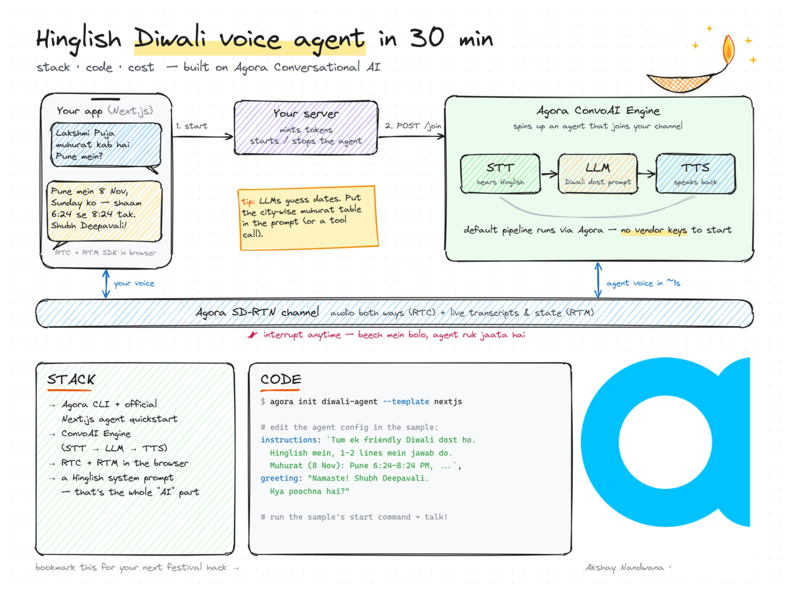

# Diwali Dost 🪔

A festive Hindi voice companion that helps you explore rangoli designs, prepare for Diwali puja, and ask festival questions. Speak naturally, interrupt mid-sentence, and follow along with Hindi captions and visual guides.

[Watch the demo video on X](https://x.com/akshay81844/status/2118566631312151038)

## Learn the architecture



This learning diagram illustrates the original quickstart flow. This repository customizes it with **Agora ARES STT**, **Smallest AI Harleen TTS** (requires `SMALLEST_API_KEY`), Hindi captions, and local visual activities. Exact festival timings use the optional lookup tool rather than model memory. The image's “~1s” response time is illustrative, not a measured guarantee; follow the setup and stack sections below for the current configuration.

## What you can do

- Talk to Diwali Dost in Hindi or Hinglish; replies and captions use Hindi in Devanagari.
- Ask “कौन सी रंगोली बनाऊँ?” to open real rangoli images in the right panel.
- Say “और तस्वीरें दिखाओ” to reveal more designs (eight curated images in total).
- Ask “पूजा कैसे करते हैं?” to open a Hindi materials checklist and ordered household puja guide.
- Keep the voice conversation and transcript visible alongside the visual panel.
- Ask today's date, using the India date supplied when the session starts.

The illustrated courtyard includes a diya, banderwal, lanterns and saffron lighting. Animations respect reduced-motion preferences.

## Requirements

- Node.js **22 or newer** and **pnpm**.
- An Agora project with Conversational AI and Signaling/RTM enabled, its App ID, and its App Certificate. Create/manage a project in the [Agora Console](https://console.agora.io/).
- A Smallest AI API key for Harleen's voice, available from the [Smallest AI dashboard](https://app.smallest.ai/dashboard).
- A modern browser and microphone. Localhost works for development; hosted microphone access requires HTTPS.

## Run locally

```bash
git clone https://github.com/anandwana001/diwali-voice-agent.git
cd diwali-voice-agent
pnpm install
cp env.local.example .env.local
```

Fill in `.env.local`:

```dotenv
NEXT_PUBLIC_AGORA_APP_ID=your_agora_app_id
NEXT_AGORA_APP_CERTIFICATE=your_agora_app_certificate
SMALLEST_API_KEY=your_smallest_ai_api_key

# Optional: public HTTPS origin of this app for exact muhurat lookups.
AGENT_TOOL_BASE_URL=
```

Only the App ID is public. Never put either private key in a `NEXT_PUBLIC_` variable or commit `.env.local`.

```bash
pnpm run doctor
pnpm run dev
```

Open [localhost:3000](http://localhost:3000), click **Baat karein**, allow microphone access, and start speaking. A text transcript is available under **Hamari baatein**. End the call before leaving the page. After changing the agent prompt, voice settings, or environment, restart the development server if needed and start a **new call**.

## Try asking

- “आज क्या तारीख है?”
- “मेरे घर के लिए कौन सी रंगोली अच्छी रहेगी?”
- “और रंगोली की तस्वीरें दिखाओ।”
- “दीवाली की पूजा कैसे करते हैं? सामग्री दिखाओ।”
- “पुणे में लक्ष्मी पूजा का मुहूर्त क्या है?” (requires the optional lookup setup below)

## Festival data and optional tools

Rangoli and puja panels open locally from your speech transcript; they do **not** require a tunnel, public tool URL, or another data API key. Direct panel buttons work too.

Exact muhurat answers use an optional Agora REST tool calling this app's `/api/festival-info` route. Set `AGENT_TOOL_BASE_URL` to the public HTTPS origin of the same running app, for example `https://your-deployment.example`, with no path. For local use, expose the app through an HTTPS tunnel and use that origin. Agora's cloud cannot call `localhost`. Restart and begin a new conversation after configuring it.

The data is a **curated local dataset**, not live Drik Panchang access: Lakshmi Puja on 8 November 2026 for Pune, Mumbai, New Delhi and Bengaluru, verified on 6 November 2026. Unsupported cities, years or festivals return unavailable. Review `lib/festival-info.ts` before using this demo for another festival/year. The agent should decline exact timings when no verified lookup is available.

The puja panel is a general household outline with source links, not every regional ritual or a full mantra collection. Rangoli photos are externally hosted, credited and linked; availability depends on their original hosts. The gallery has a finite catalog rather than live image search.

## Stack and customization

| Area | Implementation |
| --- | --- |
| App | Next.js 16, React 19, TypeScript |
| Speech recognition | Agora ARES, primary language `hi-IN` |
| Language model | Agora-managed OpenAI `gpt-4o-mini` |
| Speech | Smallest AI `lightning_v3.1`, Harleen, Hindi, 24 kHz |
| Voice / captions | Agora RTC / RTM and Agent Client Toolkit |

Edit `app/api/invite-agent/route.ts` for personality, greeting, voice and VAD. `components/FestivalActivity.tsx` contains the gallery and puja guide; `lib/visual-intent.ts` matches spoken panel requests. Theme and layout live in `app/globals.css`; illustrations live in `components/DiwaliScene.tsx`.

The current persona uses feminine first-person grammar and masculine address for the demo's user. Adjust those instructions for your audience. The clock context is a session-start snapshot in `Asia/Kolkata`, not a continuously refreshed clock.

## Checks

```bash
pnpm run verify
```

This runs doctor, lint, TypeScript, API/intent checks and a production build. Doctor needs `.env.local`; these narrower checks do not start a live call:

```bash
pnpm run lint
pnpm run typecheck
pnpm run verify:api
pnpm run build
```

Build checks do not prove microphone, provider credentials, Hindi recognition or audio quality. Test one live conversation in your own Agora project.

## Deploy

Deploy as a Next.js app, with the three required environment variables above. Use `pnpm run build` as the build command. Set `AGENT_TOOL_BASE_URL` to your public origin if enabling festival lookups, then redeploy.

The current visual flow uses browser-local transcript events. A legacy `/api/activity` route remains but uses a process-local event map: do not rely on that route for multi-instance/serverless event delivery without replacing the map with shared storage. The browser-local panels do not depend on it.

This is a public demo baseline. Add authentication, abuse protection and rate limiting before exposing unrestricted token/session creation at scale.

## Troubleshooting

- **No agent audio:** verify all three required credentials and Agora project capabilities; inspect `/api/invite-agent` errors in the server terminal.
- **No microphone:** allow browser microphone permission and use localhost or HTTPS.
- **Gallery does not open:** check that your speech appears in the transcript; try “रंगोली दिखाओ” or use the panel button.
- **Exact muhurat unavailable:** verify the optional public origin is reachable and the city/year exists in the dataset.
- **Old behavior after edits:** end the current call and start a new one.
- **Image missing:** follow its source link; an external host may block loading or remove it.

## Credits and license

Built from the [official Agora Next.js voice agent quickstart](https://github.com/AgoraIO-Conversational-AI/agent-quickstart-nextjs), with Smallest AI speech. Ritual and timing sources are linked in the app. Images retain their original owners' rights; the code license does not grant rights to third-party photographs.

Code is distributed under the [MIT license](LICENSE), retaining the upstream copyright notice.
